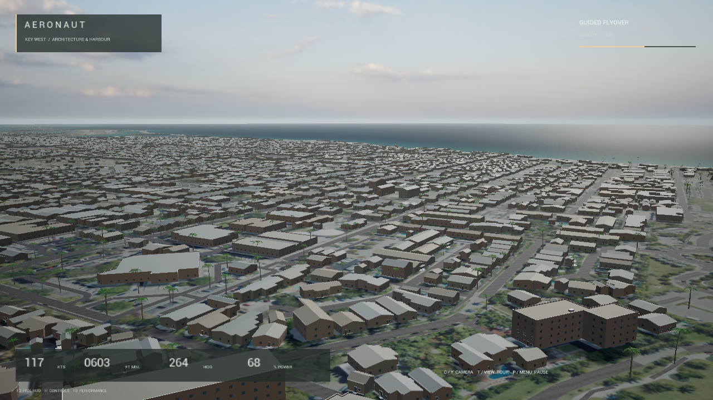
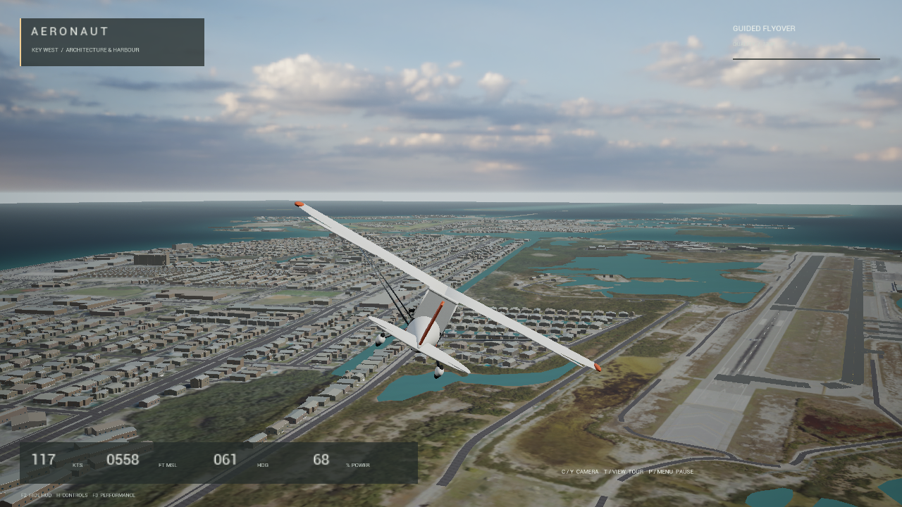
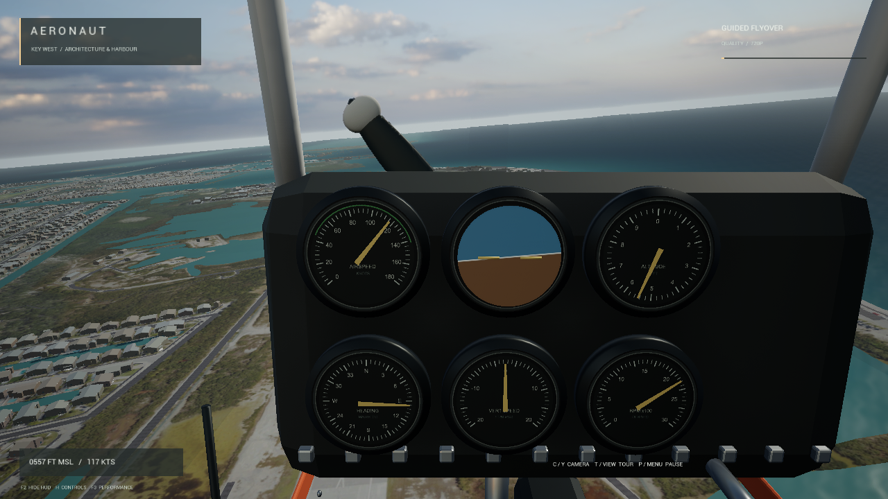
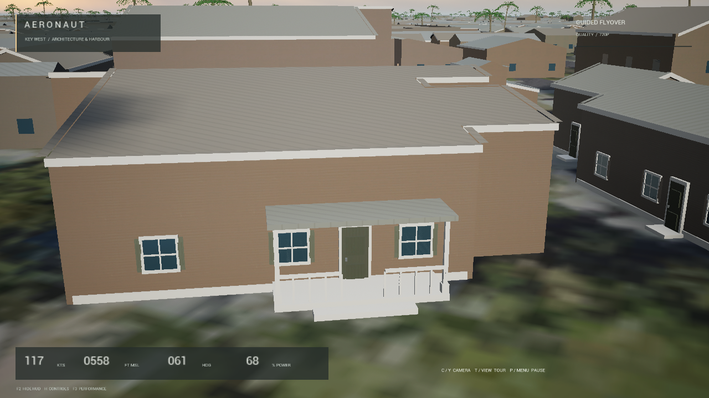
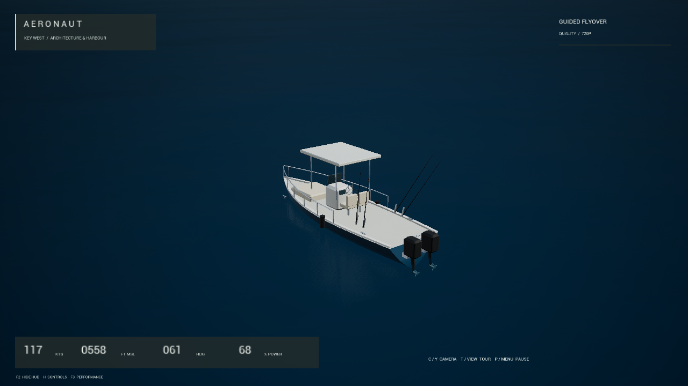

# AERONAUT — Key West Flight Showcase

An experimental Unreal Engine flight game around Key West and Stock Island: real geographic outlines, original Blender aircraft and scenery, a live cockpit, free flight and a guided tour.

Buildings and heights are inferred. The scenery remains a prototype with simplified architecture and materials.



## Play on Windows

Unreal Engine, Blender and a compiler are unnecessary for the packaged game.

1. Open the [preview release](https://github.com/johnfabian/flight-sim-unreal/releases/tag/v0.2.0-preview).
2. Download **`Aeronaut-Windows-KeyWest-v0.2.0.zip`**.
3. Extract the complete ZIP into a writable folder.
4. Open its **`Windows`** folder and double-click **`PlayKeyWest.cmd`**.
5. Press **Enter** to fly, or **T** for the guided tour.

Keep the entire extracted folder together. The game starts in a 1280×720 window. `PlayKeyWestPerformance.cmd` selects a lighter preset. These launchers explicitly select the Key West detail map; the bare executable has a different default map.

If Windows reports a missing Microsoft C++ runtime, install the included `Engine\Extras\Redist\en-us\vc_redist.x64.exe`, then retry.



## Controls

| Keyboard / Xbox controller | Action |
| --- | --- |
| Enter / A | Start or resume flight |
| S / W | Pitch up / down |
| A / D | Bank |
| Q / E | Rudder |
| Shift / Ctrl | Increase / decrease power |
| T / View | Enter or leave the guided tour |
| C / Y | Change camera |
| P / Esc / Menu | Pause or resume |
| R | Return to the airborne briefing position |
| F2 | Show or hide the overlay |
| F4 | Switch Quality / Performance |
| Alt+F4 | Exit |

Click the game window to focus its controls. Windows play pauses when the game loses focus. Controller mappings are implemented; physical USB-controller operation was not independently retested for this release.



## What is included

- Key West and Stock Island coastline, streets, airfield and inferred buildings.
- Added building facades, fuller palms and sharper ground around Old Town and the airfield.
- Six boat types and **120 anchored fishing/recreational boats**.
- Original aircraft with chase, cockpit and wing cameras and live instruments.
- Assisted airborne flight and an approximately **5-minute-21-second guided tour**.
- Earlier geographic Key West, North Coast and original Pelagos maps in the prepared content.

Boats are decorative anchored vessels. Takeoff, landing and boat driving remain outside this prototype. Professional photorealism is unfinished.





## Measured performance

The existing local game was tested on Windows with an Intel Core i9, 32 GB RAM and GTX 1650 4 GB.

| Preset | Internal rendering | Output | Result |
| --- | --- | --- | --- |
| Quality | 1280×720 | 1280×720 | 29.998 FPS average; 29.430 FPS slowest 1%; zero frames over 100 ms |
| Performance | 1088×612 | 1280×720 | Short visual and control checks |

Quality was measured with a 30 FPS cap over two complete tours after a 40-second warmup. This was an offscreen native test; window presentation and browser encoding were excluded. Results vary by computer. The public download retains the same game executable and cooked scene data; its unused vendor SDK credential setting was cleared during publication preparation. A fresh-machine runtime test of this archive has not been performed.

The project uses DirectX 11 and conventional meshes and shadows. Key West uses a movable sun and HDR ambient lighting, with Lumen, Nanite, ray tracing and baked global illumination disabled.

See [before/after views and limitations](docs/KEY_WEST_DETAIL.md) and the [publication scan](docs/PUBLICATION_SCAN.md).

## Open and edit the source project

The repository contains code, safe configuration, documentation and screenshots. Prepared Unreal content and editable art are available as **`Aeronaut-EditorAssets-v0.2.0.zip`** on the same release.

Requirements: **Windows**, **Unreal Engine 5.8** (tested with 5.8.4), **Visual Studio 2022 with C++ build tools**, and a **Windows SDK**.

```powershell
git clone https://github.com/johnfabian/flight-sim-unreal.git
Set-Location flight-sim-unreal

# Downloads, verifies and installs prepared Content and Art into this checkout.
.\Scripts\Install-ReleaseAssets.ps1 -Target Editor

.\Scripts\Unreal.ps1 -Action Build
.\Scripts\Unreal.ps1 -Action Editor -Map /Game/KeyWestDetail/KeyWestDetail
```

For a custom engine location, add `-EngineRoot 'D:\Epic Games\UE_5.8'` to the Unreal script commands. Opening the saved level does not require regenerating artwork. The first C++ build and shader compilation can take time.

To run the source project through the installed engine:

```powershell
.\Scripts\Unreal.ps1 -Action Play -Map /Game/KeyWestDetail/KeyWestDetail
```

The repository-root `PlayKeyWest.cmd` expects an installed Windows package. To install that package into the checkout, use `Install-ReleaseAssets.ps1 -Target Windows`, then run the launcher. The installation helper checks SHA256 and refuses to overwrite different existing files.

| Folder | Purpose |
| --- | --- |
| `Source/Aeronaut` | C++ flight simulation, aircraft, cameras and presentation |
| `Source/AeronautTools` | Editor support |
| `Scripts` | Build, art preparation, packaging and streaming tools |
| `Content` | Saved maps, Blueprints, meshes and materials from the editor-assets download |
| `Art` | Blender sources, FBX exports, textures, geographic data and generation scripts |
| `Tests` | Engine-independent flight tests; run `.\Scripts\Test.ps1` |
| `Streaming` | Local browser-streaming wrapper and dependency instructions |

## Blender and optional browser streaming

**Blender 4.5 LTS** is needed for modifying/regenerating models. Editable sources include `Art/KeyWestDetail/KeyWestDetail.blend`, `Art/KeyWestDetail/Ground/KeyWestGround.blend` and `Art/AeronautCoast.blend` in the editor-assets download.

Development tools and engine installations are not redistributed. See [authoring notes](docs/AUTHORING.md) before using generation actions, which can overwrite generated artwork.

Local browser streaming requires the source/editor setup, Node and the pinned dependency in [Streaming/DEPENDENCIES.md](Streaming/DEPENDENCIES.md). Run `BrowserKeyWest.cmd`, then `StopStreaming.cmd` when finished. Listeners bind to localhost. This streams from your Windows computer; no cloud or native Xbox deployment is included.

## Sources and attribution

- Geographic data: [© OpenStreetMap contributors](https://www.openstreetmap.org/copyright), with raw and derived geographic data under ODbL.
- Aerial imagery: public-domain USGS/USDA NAIP, acquired January 16, 2023.
- Supplemental textures: [Poly Haven, CC0](https://polyhaven.com/license).
- Aircraft, buildings, vegetation and boats: original Blender geometry.

Downloads retain source records and texture provenance. See [third-party notices](THIRD_PARTY_NOTICES.md), [art notes](Art/README.md), and [geographic data notes](Art/KeyWest/README_DATA.md). Unreal Engine use remains subject to Epic's terms. No project-wide open-source license has been selected for the original project files.

Native Xbox, Mac and cloud builds remain future work.
