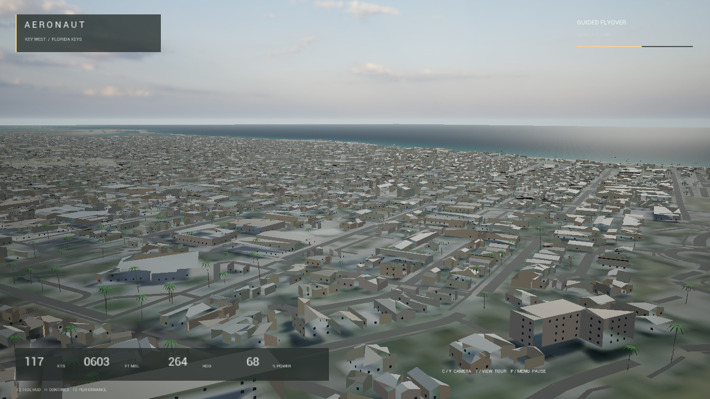
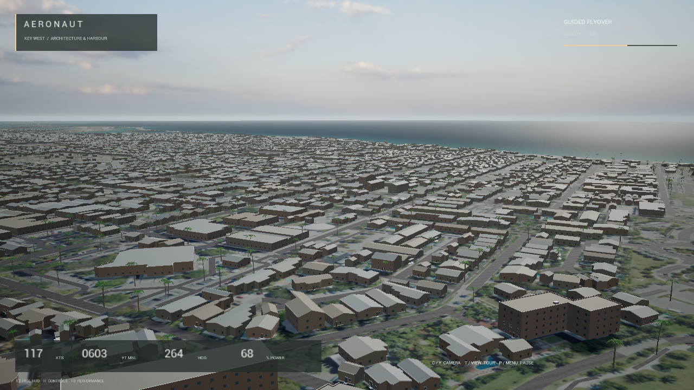
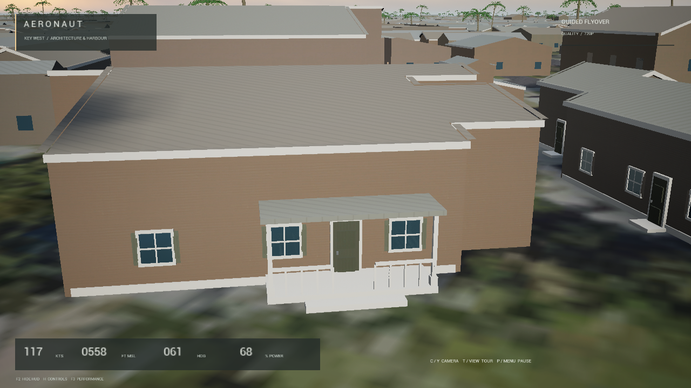
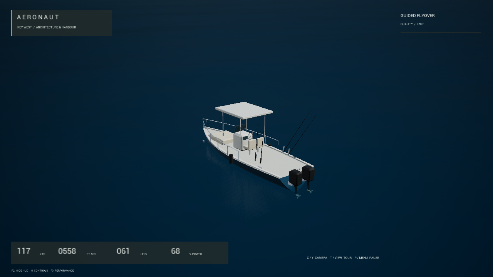

# Key West detail — actual game comparison

These are unaltered 1280×720 Unreal gameplay frames. The first two use the same saved flyover camera.

## Earlier geographic edition

## Current architecture and harbour edition

The pass added details to 10,924 buildings, including 21,412 framed windows and 608 porches, corrected 321 city meshes, replaced three palm variants at the existing 2,200 placements, and added six boat types at 120 validated anchored locations. Waterfront additions dress 180 stations on 87 piers.

Twenty-eight 2K aerial textures provide approximately 6.205 km² of nominal native 0.3 m/pixel coverage around Old Town and the airfield. Their visual overlays preserve the original ground collision.

## Closer views

Building heights and architecture are inferred from geographic footprints, rather than surveyed replicas. Repeated simple shapes, broad blank walls, restrained material response, soft close ground, coarse distant imagery and the finite horizon remain visible. This is an improved prototype; professional photorealism remains an open goal.

Four near-zero tangent/binormal import warnings on tiny ground slivers remain in the local authoring logs. Inspection found no corresponding visible failure. Ground materials use flat normals without normal maps.

The local test build passed 17 native checks for scene/collision/tour/reset/pause/instrument and import behavior. Windows keyboard checks and local editor-hosted browser compatibility were also checked. The three earlier maps loaded successfully from the complete package. Physical controllers, packaged browser hosting, native Xbox, cloud and native Mac builds were not independently validated in this release.

The [README](../README.md) contains the run instructions and measured performance. Archive hashes and installation sizes are in [release-manifest.json](../release-manifest.json). Screenshots retain their source hashes in [PUBLICATION.json](../PUBLICATION.json).
